<p align="center">
  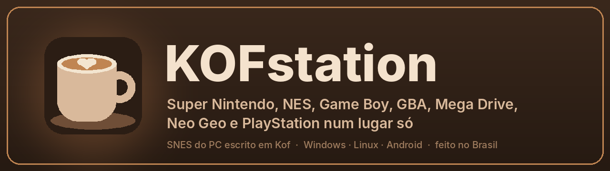
</p>

<p align="center">
  
  
  
  
  
</p>

# ☕ KOFstation

**Super Nintendo, NES, Game Boy, GBA, Mega Drive, Master System, Game Gear, Neo Geo e PlayStation num lugar só, pra facilitar a sua jogatina. O Super Nintendo do PC é escrito em [Kof](https://github.com/KofLang/Kof4j), uma linguagem brasileira parceira do projeto; os outros consoles usam núcleos abertos da comunidade (libretro).**

> O projeto começou como **KOFnes**, um emulador só de Super Nintendo. Quando chegaram os outros consoles, virou **KOFstation**.

Dois cliques no `KOFstation.exe` (no PC) ou no app do **Android** e você cai numa tela de Início bonita, com a sua biblioteca de jogos, capas, savestates com print, rebobinar o tempo, jukebox com osciloscópio, 126 temas, painel de filtros e efeitos, 15 molduras, traduções por patch e até um caçador de bugs.

<p align="center">
  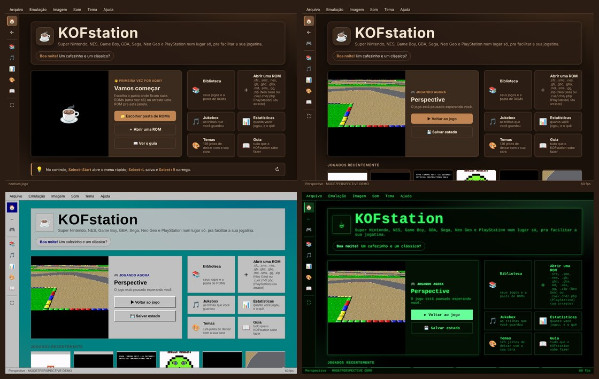
  <br><sub>A tela de Início muda conforme o momento (primeira vez, jogo pausado, continuar) e conforme o tema.</sub>
</p>

## ✨ O que ele faz

| | |
|---|---|
| 🏠 **Início** | continuar de onde parou (com print), jogados recentemente, atalhos e dica do dia. Até a frase de boas-vindas muda com o tema |
| 🧭 **Navegação** | menu lateral, botão **Voltar** com histórico (`Alt+←`, `Esc`, botão voltar do mouse) e um **Guia do KOFstation** dentro do próprio emulador |
| 🕹️ **Sistemas** | **Super Nintendo** (`.sfc`, `.smc`), **NES** (`.nes`), **Game Boy / Game Boy Color** (`.gb`, `.gbc`), **Mega Drive** (`.md`, `.gen`, `.bin`), **Master System** (`.sms`) e **Game Gear** (`.gg`), **Game Boy Advance** (`.gba`), **Neo Geo** (o `.zip` do fliperama + a sua BIOS `neogeo.zip`) e **PlayStation** (`.cue` + `.bin`, `.chd`, `.pbp`, `.iso`, ou o `.zip` com eles; BIOS opcional; no celular ainda não está otimizado) na mesma biblioteca, com o rótulo do sistema. No PC o SNES roda no núcleo em Kof; os outros em núcleos libretro em WebAssembly: [FCEUmm](https://github.com/libretro/libretro-fceumm), [Gambatte](https://github.com/libretro/gambatte-libretro) [Genesis Plus GX](https://github.com/libretro/Genesis-Plus-GX), [mGBA](https://github.com/libretro/mgba), [FBNeo](https://github.com/libretro/FBNeo) e [PCSX-ReARMed](https://github.com/libretro/pcsx_rearmed) |
| 📱 **Android** | APK com controle virtual na tela (6 modelos, multitoque, canhoto), em pé ou deitado com a tela grande e os botões nas laterais. No celular o SNES roda no [Snes9x](https://github.com/libretro/snes9x) e o Game Boy no Gambatte, em WebAssembly |
| 📚 **Biblioteca** | estilo ZSNES: escolha a pasta de ROMs uma vez, busque por palavras em qualquer ordem, esconda hacks e variantes com **Só os principais**, capas oficiais ([libretro-thumbnails](https://github.com/libretro-thumbnails)) e **modo sofá** (grade de capas pra jogar de longe, com o controle) |
| 🎨 **126 temas** | café, consoles, computador antigo, animes, animais, bem brasileiro e clássicos do SNES, com galeria de prévias ao vivo ([guia com as cores de todos](docs/guia-de-temas.html)) |
| 📺 **Imagem** | **painel de imagem** (`F4`) com 30 predefinições e 51 ajustes: TV de tubo em luz linear (linhas, máscara de fósforo, curva), monitor de fliperama, locadora VHS, Game Boy, HD de mentirinha (xBR), pintura (Kuwahara), desenho animado, Polaroid, filmadora, synthwave, gibi, cinema mudo, CGA, correção de daltonismo; comparar antes/depois e salvar o seu jeito. Proporção 4:3 / 8:7 / esticar e tela cheia |
| 🖼️ **Molduras** | galeria com 15 molduras desenhadas (TV da vó com paninho de crochê, fliperama de bar, mesa de boteco, tijolão verde, locadora, Copa do Mundo...), animações leves, uma por console e **a sua própria** (PNG com o meio transparente) |
| 🇧🇷 **Traduções** | patches `.ips`, `.bps` e `.ups`: arraste com a ROM e o jogo traduzido vira outro jogo na biblioteca, com save próprio (a ROM original não muda) |
| 🎶 **Música própria** | abertura com *Air* de Bach em violino de verdade (gravação de domínio público) e trilha brasileira no som FM do Mega Drive no Início: Se Essa Rua Fosse Minha, O Guarani, Tico-Tico no Fubá, Ó Abre-Alas, Cai Cai Balão |
| 💾 **Savestates** | por jogo, com print do momento, e **salvar automático** pra continuar de onde parou |
| ⏪ **Rebobinar** | deu ruim? segure `Backspace` (ou `Select+Y`) e o jogo volta no tempo, em preto e branco, até 5 s. Depois uma ampulheta ⏳ recarrega enquanto você joga, estilo Príncipe da Pérsia |
| 🎵 **Jukebox** | `F7` guarda a música que está tocando (SNES e Game Boy); abre e exporta `.spc`; mostra os canais do chip de som ao vivo (8 vozes no SNES, 4 canais no Game Boy) e deixa silenciar cada um. O modo **〰 Ondas** vira um osciloscópio: a forma da onda de cada canal, no estilo do tema, com **Mudo** e **Solo** |
| 📊 **Estatísticas** | tempo jogado por jogo, sessões, primeira e última vez e o gráfico dos últimos 7 dias |
| 🐞 **Caçador de bugs** | `F9` abre uma issue no GitHub já preenchida, com um pacote pra reproduzir o bug quadro a quadro |
| 🎮 **Conforto** | controle USB/Xbox, volume, mudo, turbo, pausa sozinho quando você sai da janela, teclas configuráveis |

### 🎨 Temas pro seu gosto

<p align="center">
  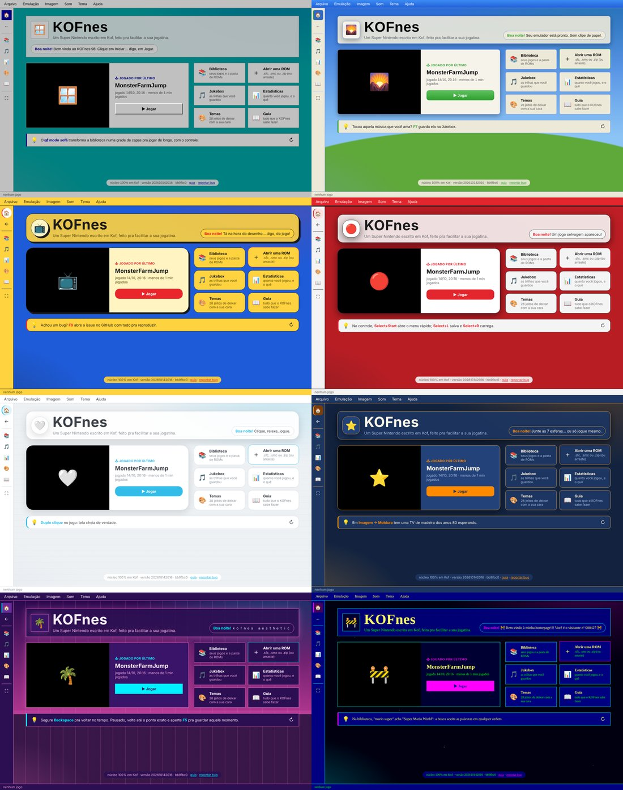
</p>

A galeria deixa você experimentar passando o mouse e escolher com um clique:

<p align="center">
  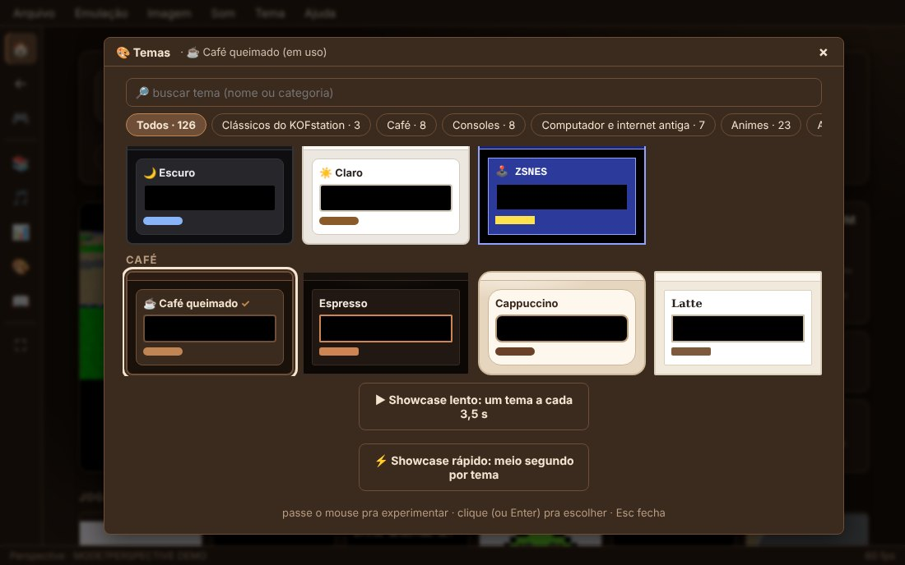
  &nbsp;
  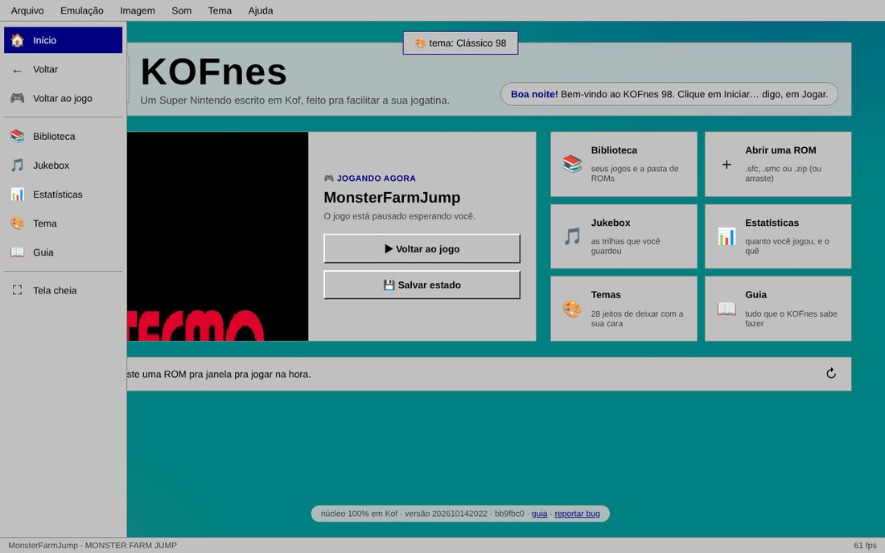
</p>

### 📚 Biblioteca, modo sofá e molduras

<p align="center">
  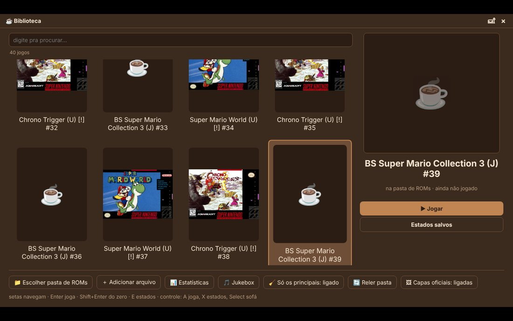
</p>

Cada jogo ganha capa oficial, baixada uma vez e guardada. Com o controle na mão, `Select` alterna pro modo sofá. Na tela de jogo, **Imagem → Galeria de molduras** coloca o jogo numa das 15 molduras (ou numa sua, em PNG):

<p align="center">
  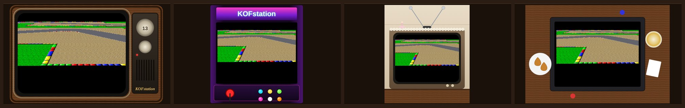
</p>

### 🎵 Jukebox, estatísticas e guia

<p align="center">
  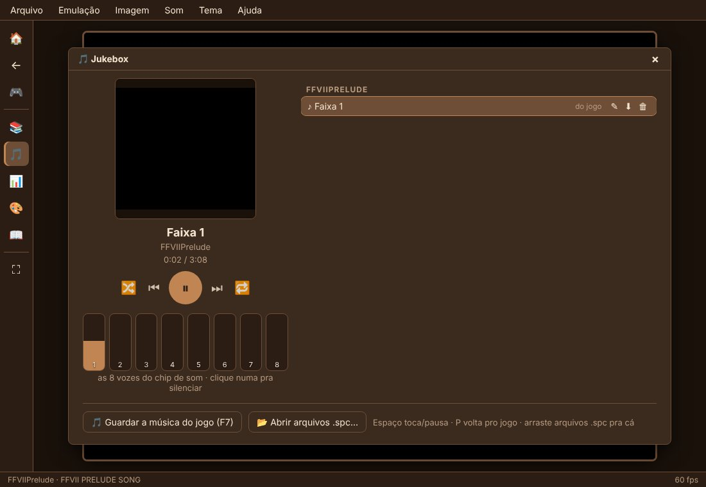
  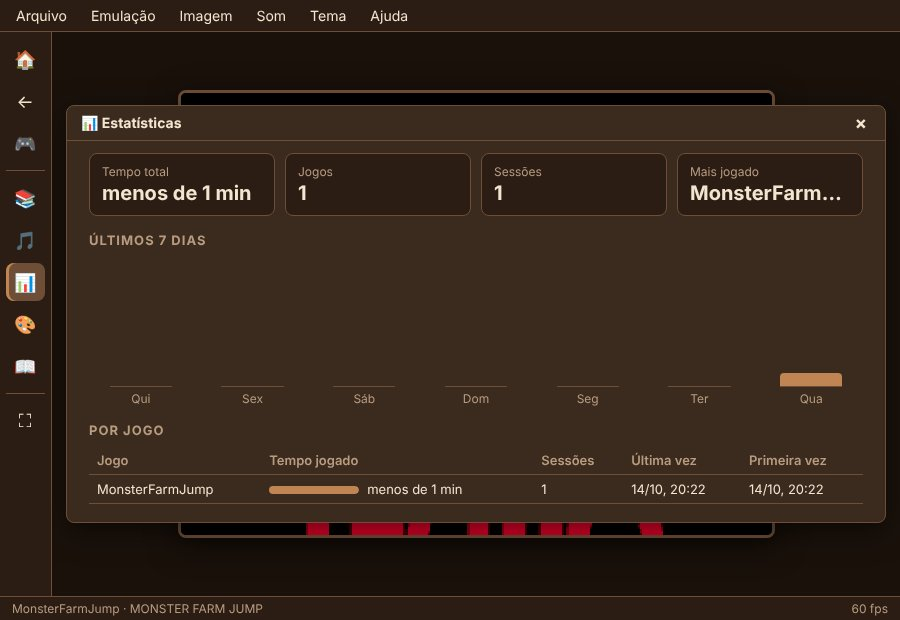
</p>
<p align="center">
  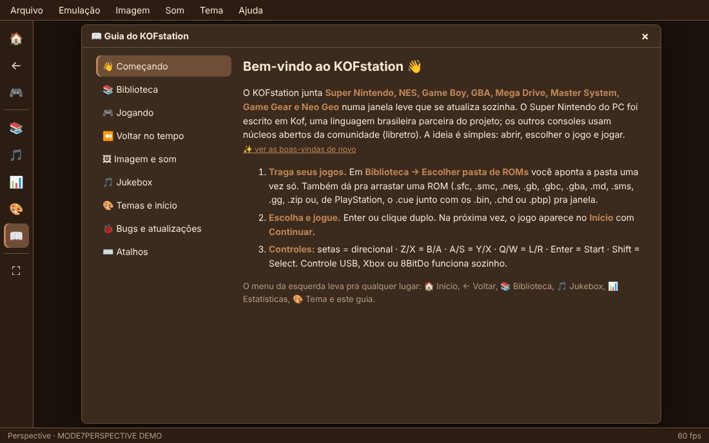
</p>

## 🎮 Como jogar

1. Baixe a pasta [`publicado/`](publicado/) (`KOFnes.exe` e `KOFnes.html`, juntos; os arquivos mantêm o nome antigo pra quem já usa continuar atualizando) ou o zip `KOFstation-windows.zip` gerado pelo `web/compilar.sh`, e deixe num lugar seu (Documentos, Área de Trabalho), **não** em *Arquivos de Programas*.
2. Dois cliques no **`KOFnes.exe`**. Ele abre o emulador numa janela do Microsoft Edge (que já vem no Windows 10 e 11) sem barra de endereço. Também dá pra abrir o `KOFnes.html` direto no Chrome ou no Edge.
3. **Arquivo → Escolher pasta de ROMs** e pronto: a lista aparece dentro do emulador (`Ctrl+L`). Ou arraste uma ROM pra janela (de PlayStation, o `.cue` junto com os `.bin`, ou um `.chd`). Jogos de PlayStation ficam na pasta de ROMs (não são copiados pra dentro do app).

**No Android:** instale o [`KOFstation.apk`](android/apk/KOFstation.apk) (app de teste, fora da Play Store: o Android vai pedir pra permitir instalar de fonte desconhecida) e toque em **Abrir uma ROM**.

> Na primeira vez o Windows pode dizer *"o Windows protegeu o computador"*: o `.exe` não tem assinatura digital. Clique em **Mais informações → Executar assim mesmo**.

### ⌨️ Atalhos principais

| Ação | Tecla | Ação | Tecla |
|---|---|---|---|
| Direcional | setas | Salvar / carregar estado | `F5` / `F8` |
| B · A | `Z` · `X` | Galeria de estados | `F6` |
| Y · X | `A` · `S` | Rebobinar | segurar `Backspace` |
| L · R | `Q` · `W` | Guardar música (Jukebox) | `F7` |
| L2 · R2 (PlayStation) | `E` · `R` | Painel de imagem | `F4` |
| Start · Select | `Enter` · `Shift` | Reportar bug | `F9` |
| Pausa · Reiniciar | `P` · `F1` | Menu rápido | botão direito, `F2` ou `Select+Start` |
| Turbo | segurar `Tab` | Biblioteca · Voltar | `Ctrl+L` · `Alt+←` |
| Tela cheia · Mudo | `F11` ou duplo clique · `M` | Volume | `-` e `=` |

No controle: `Select+L` salva, `Select+R` carrega e `Select+Y` rebobina. As teclas mudam em **Emulação → Configurar teclas**. Os saves de bateria ficam sozinhos no perfil do KOFstation (`%LOCALAPPDATA%\KOFnes`).

## 🔄 Atualiza sozinho

Ao abrir, o `KOFnes.exe` confere no GitHub (`publicado/versao.txt`) se existe versão nova e baixa o `KOFnes.html` atualizado, conferindo o tamanho antes de abrir a janela. Leva uns segundos; sem internet, abre normal. Saves, estados e biblioteca não se perdem.

- O que o atualizador fez fica anotado em `atualizacao.log`.
- Pra desligar, crie um arquivo chamado `nao-atualizar` na pasta.
- Também tem **Ajuda → Procurar atualização**.

## 🐞 Caçador de bugs

Achou um bug? Aperte `F9` (ou deixe o emulador oferecer sozinho quando ele quebrar). O KOFstation abre uma issue **já preenchida** (jogo, SHA-1, versão, navegador, erro) e baixa um pacote `kofbug` com o savestate de segundos antes e os botões apertados, quadro a quadro. É só arrastar o pacote pra dentro da issue. A ROM não vai junto.

<p align="center">
  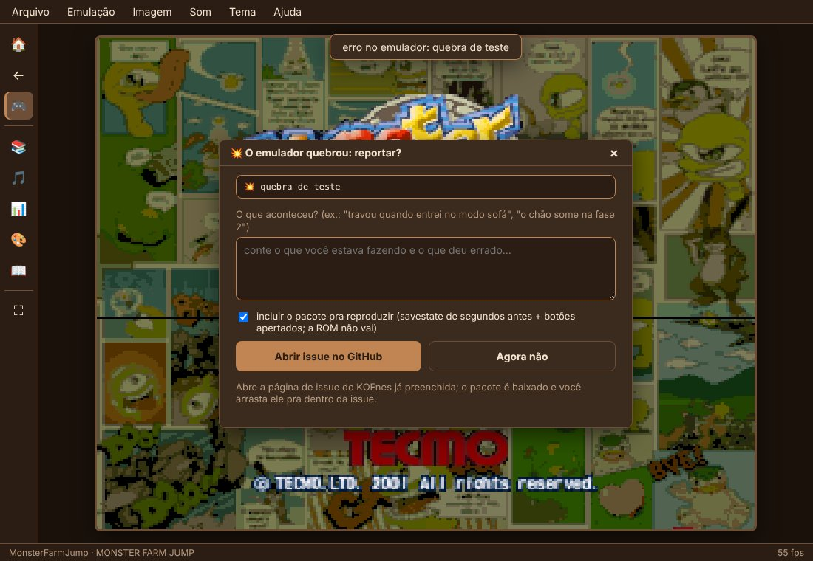
</p>

Pra reproduzir em outra máquina: `node bugs/reproduzir.cjs KOFnes.html kofbug-....json.gz minha-rom.sfc` chega exatamente na mesma imagem.

## 🔧 Por dentro

O núcleo do console é **Kof puro**, sem nenhuma biblioteca de emulação:

| Peça | Arquivo | O que faz |
|---|---|---|
| CPU 65C816 | `snes/Cpu.kf` | os 256 opcodes, modos nativo e emulação, tempo por acesso à memória |
| PPU | `snes/Ppu.kf` | modos 0 a 7 (com Mode 7), sprites, janelas, color math, mosaico, hi-res |
| SPC700 + DSP + APU | `snes/Spc.kf`, `Dsp.kf`, `Apu.kf` | a CPU e o chip de som: 8 vozes BRR, ADSR, eco, 3 timers (e a "ponta de prova" do osciloscópio) |
| Barramento | `snes/CpuBus.kf`, `Snes.kf` | mapa de memória, DMA/HDMA, IRQ/NMI, joypad |
| Cartucho | `snes/Cartridge.kf` | LoROM, HiROM e ExHiROM |
| Super FX | `snes/Gsu.kf` | o chip do *Star Fox* e do *Yoshi's Island* |

Os outros sistemas não são reescritos: o KOFstation usa núcleos que já existem no padrão **libretro**, compilados pra WebAssembly com o emscripten e ligados por uma ponte pequena ([`nucleo-libretro/`](nucleo-libretro/)). Cada núcleo tem a sua licença (Snes9x e Genesis Plus GX: só uso não comercial; Gambatte, FCEUmm e PCSX-ReARMed: GPL-2; mGBA: MPL-2.0). Os núcleos ficam em arquivos separados (`nucleos/`) e só carregam quando você abre um jogo daquele console; o atualizador baixa cada um.

O KOFstation roda direto no navegador: `web/compilar.sh` compila o mesmo `snes/` com `kof build --target js` e junta tudo, com o Gambatte, num `KOFnes.html` de ~1,5 MB. O `KOFnes.exe` é um lançador pequeno em C que abre essa página numa janela do Edge. A saída é idêntica bit a bit à da versão em JVM, a 60 fps.

```
KOFstation/
├── snes/        o console em Kof: Cpu, Ppu, Spc, Dsp, Apu, Snes, Cartridge, Gsu
├── web/         núcleo → JavaScript, interface, temas, lançador do .exe
├── nucleo-libretro/  ponte pros núcleos libretro (Snes9x, Gambatte, FCEUmm, Genesis Plus GX, mGBA, FBNeo, PCSX) em WebAssembly
├── android/     o app do Android (WebView, sem Gradle) e o APK de teste
├── publicado/   a versão que o atualizador baixa (KOFnes.exe, .html, versao.txt)
├── bugs/        reproduzir.cjs: roda os pacotes do caçador de bugs
├── app/         janela da versão com Java       ├── nativo/   versão só-Kof (SDL2)
├── tools/       testes de CPU/SPC e modo headless
└── docs/        como o SNES funciona, relatórios de bugs do Kof e reproduções
```

### Como compilar

Precisa do [Kof](https://github.com/KofLang/Kof4j) **0.6.3** com o `web/kof-js-correcoes.patch` aplicado (4 correções no alvo JS do compilador), de `python3` e, pro `.exe`, do `mingw-w64`.

```bash
nucleo-libretro/construir.sh   # Snes9x e Gambatte em WebAssembly (precisa do emscripten)
web/compilar.sh     # gera dist/web/KOFnes.html, KOFnes.exe, o KOFnes-android.html e os zips
android/construir-apk.sh       # gera dist/KOFstation.apk
web/publicar.sh     # sobe a versão pra publicado/ (depois é só commitar)
```

### Outras versões (laboratório da linguagem)

O mesmo núcleo também roda com **Java** (instalador pra Windows e pacote pra Linux, 350 a 500 fps sem janela) e em **Kof nativo** pra Linux (0,3 MB, mas ~22 fps, porque o compilador nativo ainda é jovem). Elas existem pra testar a linguagem e estão em `app/`, `empacotar/` e `nativo/`, com `./kofnes.sh` pra rodar a partir do código.

### Como foi testado

Cada peça foi medida contra suítes públicas: **cputest do gilyon 649/649**, **SingleStepTests SPC700 76.200/76.200**, **SingleStepTests 65816 151.194/152.400** (o resto é MVN/MVP e um quirk em que o KOFstation segue o hardware), além das ROMs de teste do PeterLemon e do undisbeliever. Pra entender o hardware: [`docs/como-o-snes-funciona.md`](docs/como-o-snes-funciona.md).

## 💜 Kof e a Mel

O Kof é uma linguagem brasileira nova, da **Mel Santos**: [github.com/KofLang/Kof4j](https://github.com/KofLang/Kof4j). Escrever um emulador inteiro nela foi um teste e tanto, e a linguagem aguentou muito bem. No caminho apareceram alguns bugs do compilador, todos com reprodução mínima:

- 📄 [Relatório pra humanos](docs/relatorio-kof.md) e 🤖 [relatório pra IA](docs/relatorio-kof-ia.md)
- 🧪 [Reproduções](docs/kof-repros/): um `main.kf` por problema, cada um roda com `kof run main.kf`
- 📝 [Issues prontas](docs/issues/README.md): 19 bugs já formatados pra abrir no repositório do Kof

## 🚀 Próximos passos

- [x] 📱 Versão pra **Android** (APK de teste)
- [x] 🐧 **Linux** com lançador próprio (`kofnes.sh`), como o do Windows
- [x] 🕹️ **Game Boy / Game Boy Color** e **NES** na mesma biblioteca
- [x] 🕹️ **Mega Drive, Master System e Game Gear**
- [x] 🕹️ **Game Boy Advance** (mGBA; BIOS opcional em Arquivo > BIOS…)
- [x] 🕹️ **Neo Geo** (FBNeo; modo AES, o zip inteiro do jogo, clones acham o zip do pai na biblioteca; a BIOS é sua)
- [x] 🕹️ **PlayStation** (PCSX-ReARMed; `.cue`/`.bin`, `.chd`, `.pbp`; BIOS opcional)
- [ ] 📱 PlayStation otimizado no celular (no PC roda liso; no celular ainda trava nos jogos 3D, os outros consoles rodam bem)
- [x] 🎨 Painel de filtros e efeitos, galeria de molduras e traduções por patch
- [ ] 🕹️ Analógico do PlayStation e mais sistemas (Nintendo 64, Saturn...)
- [ ] 📱 Play Store e escolher a pasta de ROMs inteira no Android
- [ ] 🏆 **Conquistas**
- [ ] Chips de cartucho que faltam: SA-1, DSP-1, Cx4, S-DD1, SPC7110

## ⚖️ Aviso

O KOFstation **não inclui ROMs** nem ensina onde baixar. Use cópias dos seus próprios cartuchos.

## Créditos

Linguagem: [Kof / Kof4j](https://github.com/KofLang/Kof4j), da Mel Santos e contribuidores. Núcleos libretro: [Snes9x](https://github.com/libretro/snes9x) (licença não comercial), [FCEUmm](https://github.com/libretro/libretro-fceumm) (GPL-2), [Genesis Plus GX](https://github.com/libretro/Genesis-Plus-GX) (licença não comercial), [Gambatte](https://github.com/libretro/gambatte-libretro) (GPL-2), [mGBA](https://github.com/libretro/mgba) (MPL-2.0), [FBNeo](https://github.com/libretro/FBNeo) (licença não comercial) e [PCSX-ReARMed](https://github.com/libretro/pcsx_rearmed) (GPL-2). Música: *Air* (J. S. Bach) pela United States Air Force Band, domínio público ([Wikimedia Commons](https://commons.wikimedia.org/wiki/File:Air.ogg)). Testes de PlayStation: [PeterLemon/PSX](https://github.com/PeterLemon/PSX). Testes: [SingleStepTests](https://github.com/SingleStepTests), [gilyon](https://github.com/gilyon/snes-tests), [PeterLemon](https://github.com/PeterLemon/SNES), [undisbeliever](https://github.com/undisbeliever/snes-test-roms). Capas: [libretro-thumbnails](https://github.com/libretro-thumbnails). Versão só-Kof: [SDL2](https://www.libsdl.org/) (zlib).
