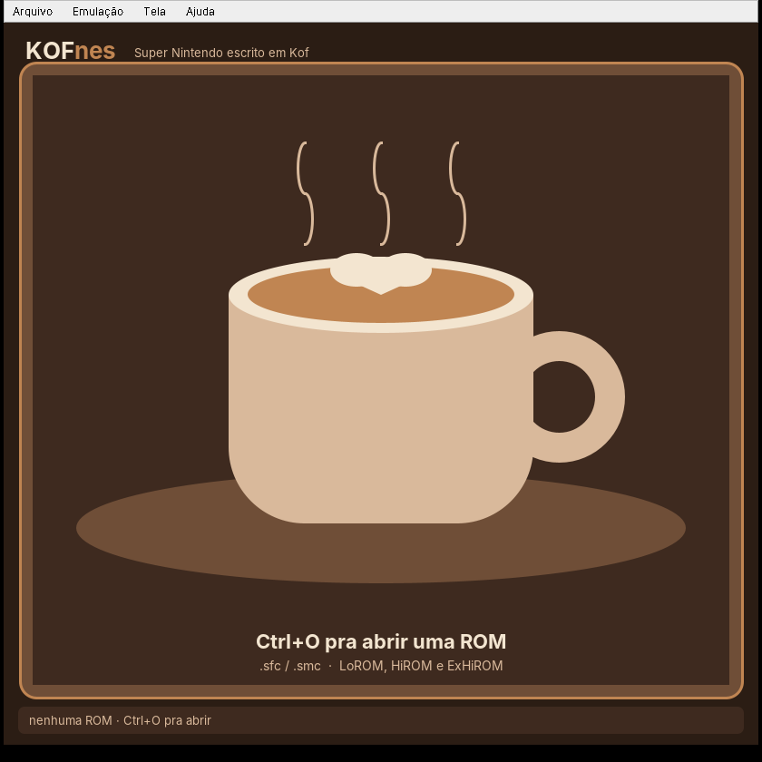

# KOFnes ☕

Emulador de **Super Nintendo** escrito do zero em [Kof](https://github.com/KofLang/Kof4j),
uma linguagem lançada mês passado (versão 0.6.3, beta). Tema cappuccino porque sim.



## Baixar e jogar

Pacotes prontos, com o Java já embutido (não precisa instalar nada):

- **Windows:** `KOFnes-windows-x64.zip` → extrair → dois cliques em `KOFnes.exe`
- **Linux:** `KOFnes-linux-x64.tar.gz` → extrair → `./KOFnes/KOFnes`

Abre `.sfc`, `.smc` ou `.zip` com a ROM dentro (Ctrl+O, ou arrastando a ROM em
cima do `KOFnes.exe`). Se o jogo tem bateria, o save vai pra `jogo.srm` do lado
da ROM. Na primeira vez o Windows pode avisar "o Windows protegeu o computador"
porque o `.exe` não é assinado: "Mais informações" → "Executar assim mesmo".

Pra gerar os pacotes de novo: `empacotar/empacotar.sh` (precisa de Kof, JDK 25,
Python com Pillow, gcc e mingw-w64; o Java embutido vem do pacote `jdk4py` do
PyPI). Sai tudo em `dist/`.

## Rodando a partir do código

Com o Kof instalado (`kof` no PATH; o Kof 0.6.3 pede **Java 25**):

```bash
./kofnes.sh                # abre a janela; Ctrl+O escolhe a ROM
./kofnes.sh jogo.sfc       # já abre o jogo
kofnes.bat jogo.sfc        # no Windows
```

### Controles

| SNES | Teclado |
|---|---|
| Direcional | setas |
| B / A | Z / X |
| Y / X | A / S |
| L / R | Q / W |
| Start / Select | Enter / Shift |
| Turbo (4×) | Tab (segurar) |
| Pausa | P ou Esc |
| Reiniciar | F1 |
| Abrir ROM | Ctrl+O |

## O que foi emulado

Tudo em Kof, sem biblioteca de emulação nenhuma (só AWT/Swing e
javax.sound do Java pra janela e som):

| Peça | Arquivo | O que faz |
|---|---|---|
| CPU 65C816 | `snes/Cpu.kf` | os 256 opcodes, modo emulação/nativo, flags M/X, decimal, MVN/MVP, WAI/STP, NMI/IRQ, ciclos por acesso |
| SPC700 | `snes/Spc.kf` | CPU do som: 256 opcodes, MUL/DIV, DAA/DAS, operações de bit |
| S-DSP | `snes/Dsp.kf` | 8 vozes BRR, ADSR/GAIN, interpolação gaussiana, ruído, pitch modulation, eco com FIR de 8 taps |
| APU | `snes/Apu.kf` | 64 KB de RAM do som, ROM de boot (IPL), 3 timers, portas $2140-$2143 |
| PPU | `snes/Ppu.kf` | modos 0-7, Mode 7 (rotação/zoom/EXTBG), 2/4/8bpp, tiles 16×16, sprites com todos os tamanhos, janelas, color math (soma/subtração/meio), cor direta, mosaico, offset-per-tile, hi-res 5/6 |
| Barramento | `snes/Snes.kf` | mapa de memória, DMA (8 canais), HDMA (direto e indireto), contadores H/V, IRQ por H/V, NMI, joypad (auto e serial), multiplicação/divisão, FastROM, refresh de DRAM |
| Cartucho | `snes/Cartridge.kf` | detecção de LoROM/HiROM/ExHiROM pelo cabeçalho, espelhamento, SRAM |
| Super FX | `snes/Gsu.kf` | o chip RISC do Star Fox/Yoshi's Island: todas as instruções, pipeline com delay slot, cache de código, PLOT/RPIX em 2/4/8bpp e alturas 128/160/192/OBJ, buffer de ROM, IRQ pro SNES |
| Janela | `app/` | tela na "xícara", menu, teclado, áudio de 32 kHz, pausa/turbo, escala 2×/3×/4× |

O relógio é o master clock de 21,477 MHz: cada acesso da CPU custa 6/8/12
ciclos conforme a região, a PPU desenha cada linha no hblank, o HDMA roda
na mesma hora e o APU anda sincronizado (por linha e a cada acesso às
portas de som).

## Como foi testado

- **65C816 contra os [SingleStepTests](https://github.com/SingleStepTests/65816)**:
  151.194 de 152.400 casos certos (registradores, memória **e** quantidade de
  ciclos de barramento). Os que sobram: MVN/MVP (o SST mede eles de outro
  jeito, e a ROM de teste abaixo passa) e um quirk de `(dp,X)` em modo
  emulação onde o SST discorda do teste feito em hardware real — o KOFnes
  segue o hardware.
- **65C816 contra a [cputest do gilyon](https://github.com/gilyon/snes-tests)**
  (validada num SNES de verdade): **649/649, "Success"**.
- **SPC700 contra os [SingleStepTests](https://github.com/SingleStepTests/spc700)**:
  **76.200/76.200**, com contagem de ciclos batendo em todos.
- **Super FX contra as ROMs do PeterLemon** (`CHIP/GSU`): os ~30 testes de
  instrução dão PASS e as 27 demos de plotagem (pixel, linha, polígono em
  2/4/8bpp × 128/160/192 linhas) saem certas.
- **108 ROMs de teste do [undisbeliever](https://github.com/undisbeliever/snes-test-roms)**
  (compiladas aqui): janelas, HDMA (direto, indireto, pra CGRAM), remapeamento
  de VMAIN, autojoy, IPL. Pegaram dois desvios que foram corrigidos: escrita
  em VRAM fora do vblank é ignorada, e o HDMA cancela o DMA geral do mesmo
  canal.
- **ROMs de teste do [PeterLemon](https://github.com/PeterLemon/SNES)**: os
  testes de CPU e SPC700 dão PASS; as demos de PPU (BG 2/4/8bpp, HiColor
  por HDMA, Mode 7, mosaico, janelas, anéis, ondas) aparecem certas; as
  músicas (Prelúdio de FF VII, Axel F, Twinkle...) tocam; o joguinho
  homebrew *Monster Farm Jump* chega no título e na seleção de fase pelo
  controle.

Pra rodar os testes de CPU (os arquivos do SST são convertidos pra texto
antes, um caso por linha):

```bash
kof run KOFnes.kf testar-cpu <pasta>     # 65C816
kof run KOFnes.kf testar-spc <pasta>     # SPC700
kof run KOFnes.kf headless rom.sfc 600 saida.png   # 600 frames sem janela -> PNG + WAV
```

## O que não tem

- Chips de expansão além do Super FX: SA-1 (Super Mario RPG, Kirby Super
  Star), DSP-1 (Super Mario Kart, Pilotwings), S-DD1, SPC7110, Cx4. Esses
  jogos não rodam. O Super FX roda com tempo aproximado (orçamento de
  ciclos por linha), não ciclo a ciclo.
- Entrelaçado (512×448) é desenhado como 256×224; hi-res (modos 5/6 e
  pseudo-hires) é reduzido pra 256 de largura.
- Save state, gamepad USB e remapear teclas.
- A precisão é por instrução/linha, não por ciclo/pixel: truques de
  meio-de-linha muito agressivos podem sair diferentes.

## Kof: o que foi encontrado no caminho

A linguagem aguentou bem: o compilador gera bytecode JVM de verdade, então
o emulador roda a ~160–270 fps sem janela. Coisas que apareceram:

- `fn` e `val` são palavras reservadas (não dá pra usar como nome).
- Um só `main()` por módulo, e o módulo é a pasta do arquivo — por isso
  tudo entra pelo `KOFnes.kf` com subcomandos.
- `switch` com `case X -> { bloco }` não existe como statement; é
  `case X:` com corpo, sem fallthrough.
- `for-in` não itera `java.util.List` (só `List` do Kof e arrays).
- Bug: `Files.write(path, Byte[])` escolhe o overload de `Iterable` e gera
  bytecode inválido (`VerifyError`) — contornado com `FileOutputStream`.
- Bug: dentro de `try`, chamar um método da própria classe pelo nome
  (`sramPath(x)`) às vezes é resolvido como função do `Main` e explode com
  `NoSuchMethodError` — contornado com `this.sramPath(x)`.
- `System.arraycopy` não aceita `Int[]` como `Object` no typechecker.
- Bug: `new ZipInputStream(new FileInputStream(p))` grava no bytecode o
  construtor com o tipo exato do argumento (`FileInputStream`) em vez do
  declarado (`InputStream`) → `NoSuchMethodError`. Contornado com
  `as InputStream`.
- Campos públicos de classes Java (`rect.height`) não resolvem; use os
  getters.
