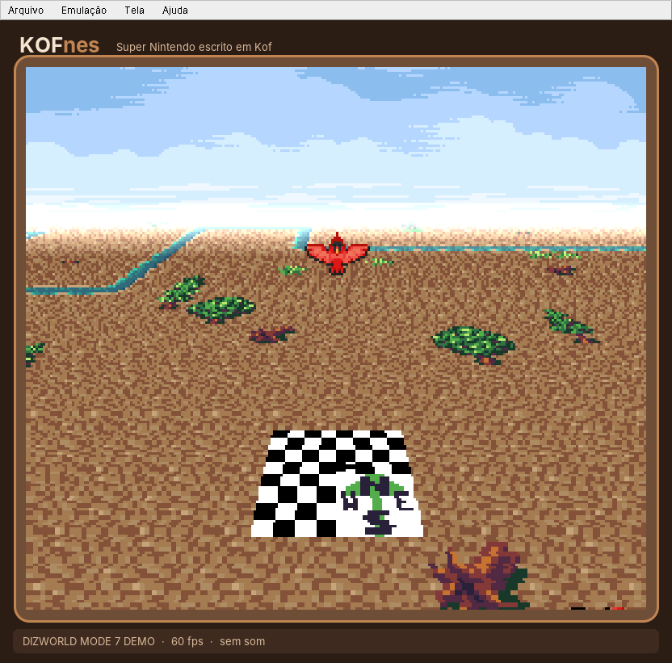

<p align="center">
  
</p>

<p align="center">
  
  
  
  
</p>

<p align="center">
  <b>Emulador de Super Nintendo escrito do zero em <a href="https://github.com/KofLang/Kof4j">Kof</a></b> —
  uma linguagem lançada mês passado.<br>
  CPU, chip de som, vídeo, Mode 7 e até o Super FX. ~6.600 linhas de Kof, zero biblioteca de emulação.<br>
  <i>Tema cappuccino porque sim.</i> ☕
</p>

---

<table>
<tr>
<td width="50%"></td>
<td width="50%"></td>
</tr>
<tr>
<td align="center"><sub>a tela inicial</sub></td>
<td align="center"><sub>Mode 7 em perspectiva a 60 fps (<a href="#créditos">dizworld</a>)</sub></td>
</tr>
</table>

## ☕ Baixar e jogar

| Sistema | Pacote | Como abrir |
|---|---|---|
| **Windows** (x64) | `KOFnes-instalador-windows.exe` · **12 MB** (15 MB instalado) | dois cliques → instala (sem pedir administrador) → ícone na área de trabalho |
| **Windows** (x64), portátil | `KOFnes-windows-x64.zip` · 13 MB | extrair → dois cliques em **`KOFnes.exe`** |
| **Linux** (x64) | `KOFnes-linux-x64.tar.xz` · 23 MB | extrair → `./KOFnes/KOFnes` |
| **Windows**, **sem Java** | `KOFnes-sem-java-windows.zip` · **0,1 MB** | extrair → dois cliques em **`KOFnes.exe`** (abre numa janela do Edge) |
| **Qualquer sistema**, navegador | `KOFnes.html` · 0,3 MB | abrir no Chrome/Edge |
| **Linux** (x64), **só Kof** | `KOFnes-so-kof-linux-x64` · **0,3 MB** | `./KOFnes-so-kof-linux-x64 jogo.sfc` (veja o [tradeoff](#-duas-versões-com-java--só-kof)) |

**Não precisa instalar Java**: ele vai junto, numa versão podada só com o que
o KOFnes usa. Depois é só **Ctrl+O** e escolher a ROM (`.sfc`, `.smc` ou um
`.zip` com a ROM dentro). Também dá pra arrastar a ROM em cima do `KOFnes.exe`.

> Na primeira vez o Windows pode dizer *"o Windows protegeu o computador"*: o
> `.exe` não tem assinatura digital. Clique em **Mais informações → Executar
> assim mesmo**.

Saves de bateria vão pra `nome-da-rom.srm`, do lado da ROM (automático a cada
~30 s e ao sair pelo menu).

## 🎮 Controles

| SNES | Teclado | | Emulador | Teclado |
|---|---|---|---|---|
| Direcional | setas | | Abrir ROM | **Ctrl+O** |
| B · A | **Z** · **X** | | Pausa | **P** / **Esc** |
| Y · X | **A** · **S** | | Reiniciar | **F1** |
| L · R | **Q** · **W** | | Turbo 4× | **Tab** (segurar) |
| Start · Select | **Enter** · **Shift** | | Escala 2×/3×/4× | menu **Tela** |

## 🌐 Sem Java: o núcleo em Kof compilado pra JavaScript

`web/compilar.sh` compila o mesmo `snes/` com `kof build --target js` e monta
**um arquivo só**, `KOFnes.html` (329 KB), mais um `KOFnes.exe` de 67 KB que
abre essa página numa janela de app do Edge (que já vem no Windows 10/11).
Sem Java, sem instalar nada, **60 fps** e saída idêntica bit a bit à do JVM.

- **4 temas**: Café queimado, Escuro, Claro e ZSNES (menu **Tema**; fica salvo).
- **Lista de ROMs dentro da janela**, estilo ZSNES: escolha a pasta uma vez
  (**Arquivo → Escolher pasta de ROMs**), depois **Ctrl+L**, digite pra filtrar
  e Enter. Também abre `.sfc`, `.smc` e `.zip`, ou é só arrastar a ROM.
- Saves de bateria automáticos, controle USB/Xbox, tela cheia (F11), mudo (M).

Pra compilar, o alvo JS do Kof 0.6.3 precisou de 4 correções no compilador
(`web/kof-js-correcoes.patch`, aplicar no Kof4j): sem elas o núcleo nem
compila, ou compila errado em silêncio (e roda a 0,3 fps). Detalhes nos
[relatórios](docs/relatorio-kof.md).

## ⚖️ Duas versões: com Java × só Kof

O núcleo (`snes/`) é **Kof puro**, sem nenhuma linha de Java, e é o mesmo nas
duas versões. Elas só mudam no que fica em volta:

| | **Com Java** (`app/` + `empacotar/`) | **Só Kof** (`nativo/`) |
|---|---|---|
| Tamanho | 12 MB (instalador), 15 MB instalado | **0,3 MB** |
| Velocidade | **350–500 fps** sem janela; os jogos rodam a 60 fps com folga | **~22 fps**: o jogo anda a ~1/3 da velocidade |
| Sistemas | Windows e Linux | só Linux x64 (no Windows, pelo WSL) |
| Janela | menu, Abrir ROM, pausa, escala, `.zip` | SDL2: ROM pela linha de comando ou arrastada pra janela; só `.sfc`/`.smc` |
| Precisa | nada (o Java vai junto) | `libsdl2-2.0-0` (`sudo apt install libsdl2-2.0-0`) |
| Saída | idêntica bit a bit: mesma tela, mesmo som | |

**Por que o só-Kof é lento?** O compilador nativo do Kof ainda é jovem: ele
gera código de pilha (cada conta faz `push`/`pop`, toda variável fica na
memória, todo acesso a array é uma chamada de função). Num laço simples ele é
~16× mais lento que o mesmo programa no Java, e o `--release` não muda isso. O
Java tem um JIT de 25 anos por trás. Quando o alvo nativo do Kof ganhar
registradores e acesso a array em linha, a versão só-Kof fica rápida **sem mudar
uma linha do emulador**. Está no [relatório](docs/relatorio-kof.md) (item 12).

**Como o Java ficou com 15 MB instalado:** o pacote leva só os módulos
`java.base` e `java.desktop`, e dentro deles só as classes que o KOFnes carrega
numa sessão de verdade (medidas com `-Xlog:class+load` pelo próprio
`KOFnes.exe`), mais as classes de erro e os pacotes que mudam de um Windows pro
outro (som, janela, fontes). A janela usa AWT puro, sem Swing. As DLLs do Java
vão comprimidas com UPX e o runtime do C fica com o do Windows 10/11.

## 🧩 O que tem dentro

```
                 ┌──────────────── Snes.kf ─────────────────┐
  ROM ──► Cartridge ──► barramento 24 bits, DMA/HDMA, IRQ/NMI, joypad
                 │            │                 │
              Cpu.kf       Ppu.kf            Apu.kf ──► Spc.kf + Dsp.kf
             65C816     vídeo por linha     64 KB de RAM de som, timers
                 │            │                        │
              Gsu.kf     framebuffer            32 kHz estéreo
            (Super FX)        └─────► app/Janela.kf ◄──┘
                                  janela, teclado, som, saves
```

| Peça | Arquivo | O que faz |
|---|---|---|
| **CPU 65C816** | `snes/Cpu.kf` | os 256 opcodes, modo nativo e emulação, flags M/X, decimal, MVN/MVP, WAI/STP, NMI/IRQ, tempo por acesso à memória |
| **SPC700** | `snes/Spc.kf` | a CPU do som: 256 opcodes, MUL/DIV, DAA/DAS, operações de bit |
| **S-DSP** | `snes/Dsp.kf` | 8 vozes BRR, envelopes ADSR/GAIN, interpolação gaussiana, ruído, pitch modulation, eco com FIR de 8 taps |
| **APU** | `snes/Apu.kf` | RAM do som, ROM de boot (IPL), 3 timers, portas $2140–$2143 |
| **PPU** | `snes/Ppu.kf` | modos 0–7, Mode 7 (rotação, zoom, EXTBG), 2/4/8bpp, sprites de todos os tamanhos, janelas, color math, cor direta, mosaico, offset-per-tile, hi-res |
| **Barramento** | `snes/Snes.kf` | mapa de memória, DMA de 8 canais, HDMA direto/indireto, contadores H/V, IRQ por H/V, multiplicação/divisão, FastROM, refresh de DRAM |
| **Cartucho** | `snes/Cartridge.kf` | LoROM / HiROM / ExHiROM pelo cabeçalho, espelhamento, SRAM |
| **Super FX** | `snes/Gsu.kf` | o chip RISC do Star Fox e do Yoshi's Island: instruções, pipeline com delay slot, cache, PLOT/RPIX |
| **Janela** | `app/` | a "xícara", menu, teclado, áudio, pausa, turbo, escala automática, ROMs em `.zip` |

O relógio é o master clock de 21,477 MHz: cada acesso da CPU custa 6, 8 ou
12 ciclos conforme a região, a PPU desenha cada linha no hblank junto com o
HDMA, e o APU e o Super FX andam sincronizados.

## ✅ Como foi testado

Não teve "parece que funciona": cada peça foi medida contra uma suíte de testes
pública.

| Suíte | O que mede | Resultado |
|---|---|---|
| [SingleStepTests 65816](https://github.com/SingleStepTests/65816) | registradores, memória **e ciclos** de cada instrução | **151.194 / 152.400**, ciclos exatos em todos que passam¹ |
| [cputest do gilyon](https://github.com/gilyon/snes-tests) | CPU, validada num SNES real | **649 / 649 — "Success"** |
| [SingleStepTests SPC700](https://github.com/SingleStepTests/spc700) | CPU do som, com ciclos | **76.200 / 76.200** |
| [ROMs do PeterLemon](https://github.com/PeterLemon/SNES) | CPU, SPC700, PPU, Mode 7, HDMA, músicas | testes de CPU/SPC: PASS · demos de PPU e músicas: certas |
| [ROMs do PeterLemon — GSU](https://github.com/PeterLemon/SNES/tree/master/CHIP/GSU) | Super FX | 31 testes de instrução: PASS · 27 demos de desenho: certas |
| [ROMs do undisbeliever](https://github.com/undisbeliever/snes-test-roms) | 108 testes de hardware (compilados aqui) | janelas, HDMA, VMAIN, autojoy, IPL, VRAM fora do vblank |
| [bbbradsmith](https://github.com/bbbradsmith/SNES_stuff), [nesdoug](https://github.com/nesdoug) | demos e jogos homebrew | todos rodando |
| **Jogo comercial, num Windows de verdade** | *Mega Man X* (13/10/2026) | **rodou liso a 61 fps, com som** 🎉 |

<sub>¹ O que sobra é MVN/MVP (o SST mede essas instruções de outro jeito; a
cputest de hardware passa) e um quirk de `(dp,X)` em modo emulação em que o
SST discorda do teste feito em hardware real — o KOFnes segue o hardware.</sub>

## 🚧 O que ainda não roda

- **Chips de cartucho além do Super FX**: SA-1 (*Super Mario RPG*, *Kirby Super
  Star*), DSP-1 (*Super Mario Kart*, *Pilotwings*), Cx4 (*Mega Man X2/X3*),
  S-DD1, SPC7110.
- Entrelaçado (512×448) sai em 256×224; hi-res (modos 5/6) é reduzido pra 256
  de largura.
- Save state, gamepad USB, remapear teclas.
- A precisão é por instrução/linha, não por ciclo/pixel: truques de meio de
  linha muito agressivos podem sair diferentes.
- Jogo comercial testado até agora: só o *Mega Man X* (rodou liso). Os testes
  acima dizem que a base está sólida, mas cada jogo tem seus caprichos.

## 🛠️ Rodando e empacotando a partir do código

Precisa do [Kof](https://github.com/KofLang/Kof4j) 0.6.3+ (`kof` no PATH) e de
**Java 25**.

```bash
./kofnes.sh                 # abre a janela        (kofnes.bat no Windows)
./kofnes.sh jogo.sfc        # já abre o jogo

kof run KOFnes.kf headless rom.sfc 600 tela.png   # 600 frames sem janela -> PNG + WAV
kof run KOFnes.kf testar-cpu <pasta>              # SingleStepTests 65816 (convertidos pra texto)
kof run KOFnes.kf testar-spc <pasta>              # SingleStepTests SPC700

empacotar/empacotar.sh      # gera o instalador, o zip do Windows e o .tar.xz do Linux em dist/
empacotar/testar-interface.sh linux      rom.zip   # teste de interface do pacote
empacotar/testar-interface.sh windows    rom.zip   # o mesmo com o .exe, no Wine
empacotar/testar-interface.sh instalador rom.zip   # instala em silêncio no Wine e testa
nativo/compilar.sh          # versão só-Kof: dist/KOFnes-so-kof-linux-x64
web/compilar.sh             # sem Java: dist/web/KOFnes.html + KOFnes.exe
```

O teste de interface faz o que um usuário faz: abre o programa, clica em
**Arquivo → Abrir ROM**, escolhe a ROM no diálogo, espera o título, aperta
**Start** e confere a tela em cada passo. Ele existe porque a primeira versão
do pacote passou em todos os testes do motor e mesmo assim não abria ROM pelo
menu.

O `empacotar.sh` precisa de Python com Pillow, gcc, mingw-w64 e NSIS; o Java embutido
vem do pacote [`jdk4py`](https://pypi.org/project/jdk4py/) do PyPI.

```
KOFnes/
├── KOFnes.kf          ponto de entrada (janela e subcomandos)
├── snes/              o console: Cpu, Spc, Dsp, Apu, Ppu, Snes, Cartridge, Gsu
├── app/               janela, controle, som, tema cappuccino (versão com Java)
├── nativo/            versão só-Kof: janela/som pela SDL2 via extern
├── web/               sem Java: núcleo Kof → JavaScript, interface, temas, KOFnes.exe
├── tools/             testes de CPU/SPC e o modo headless
├── empacotar/         lançadores, instalador, poda do Java, script dos pacotes
└── docs/              imagens, relatório de bugs da Kof e reproduções
```

## 🐛 Kof: o que encontrei no caminho

A linguagem aguentou muito bem: o compilador gera bytecode JVM de verdade, e o
emulador roda a 160–280 fps sem janela. No caminho apareceram alguns bugs do
compilador, todos com reprodução mínima:

- 📄 **[Relatório para humanos](docs/relatorio-kof.md)**: curto, só o essencial.
- 🤖 **[Relatório para IA](docs/relatorio-kof-ia.md)**: completo, com
  reprodução, saída esperada × obtida, onde no compilador olhar e como testar a
  correção.
- 🧪 **[Reproduções](docs/kof-repros/)**: um `main.kf` por problema; cada um
  roda com `kof run main.kf`.

## Créditos

- Linguagem: [Kof / Kof4j](https://github.com/KofLang/Kof4j), da Mel Santos e
  contribuidores.
- Testes: [SingleStepTests](https://github.com/SingleStepTests),
  [gilyon](https://github.com/gilyon/snes-tests),
  [PeterLemon (krom)](https://github.com/PeterLemon/SNES),
  [undisbeliever](https://github.com/undisbeliever/snes-test-roms),
  [bbbradsmith](https://github.com/bbbradsmith/SNES_stuff),
  [nesdoug](https://github.com/nesdoug).
- Print do Mode 7: a demo *dizworld*, de Brad Smith (CC BY 4.0), com arte do
  OpenGameArt: *16x16 Forest Tiles* de Sharm (CC BY 4.0), *Ocean Background* de
  KnoblePersona (CC BY 3.0) e *LPC Birds* de bluecarrot16 (CC BY 4.0).
- Java embutido nos pacotes: OpenJDK 25, via [jdk4py](https://pypi.org/project/jdk4py/).
- Versão só-Kof: [SDL2](https://www.libsdl.org/) (zlib).

ROMs não acompanham o programa. Use cópias dos seus próprios cartuchos.
